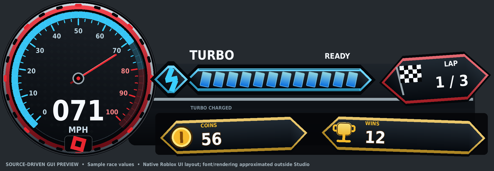

# Fun Run racing kart — instrument HUD and half-second turbo

This updates the same compact kart system at **84% scale**. The concept-based body has a curved tapered red hood, a white center racing stripe with a centered red tilted-square emblem, white/blue curved bumper, black bucket seat, yellow rims and visible tire tread. Branded red side roundels, metallic shocks with blue coil springs, and black/yellow rear exhausts add the reference details. The seat remains sized for standard R15; the avatar is never scaled. This is an assembled-Part recreation, not an exact mesh replica of the concept render.

The preview uses the actual builder's exported Parts, with Blender studio lighting and softened rendering edges. It is not a Roblox Studio screenshot or evidence of avatar fit/physics behavior. No uploaded meshes, external textures, plugins, secrets or HTTP settings are required.

## Update the kart already in your game

1. Download/extract the latest **dist/KartRelease.zip**. Stop Play and save your place.
2. Insert **dist/KartPackage.rbxmx** into Workspace using **Insert from File**. Select the newly imported **KartPackage** folder.
3. Open Studio's **Command Bar**, paste all of **tools/Upgrade.command.luau**, and press Enter.
4. Wait for **“Kart installed/upgraded.”** Press Play to generate the new kart.

The command now handles first installations, complete upgrades, and partial installations. **Install.command.luau and Upgrade.command.luau are identical**, so neither produces the old “use first installation” dead end. Do not import a second driving system.

Existing installations are cloned and verified under **ServerStorage/KartBackups/BeforeUpgrade_…** before replacement. The installer replaces only the seven named kart modules and two driving scripts; other custom modules and **Workspace/KartSpawns** remain. Compatible custom driving/camera tuning, palette and spawn position carry over. New coordinated model scale, wheel radius, wheelbase and suspension dimensions take the release defaults; old custom geometry values remain available in the backup. Retired drift tiers are not migrated. Upgrading from releases 1–4 applies the new 0.50-second threshold and activation mode so old 0.9/1.5-second settings cannot silently persist. Other compatible custom tuning remains. Release 5 timing can subsequently be configured explicitly. Custom modifications to the replaced script source are backed up, not automatically merged.

To roll back in Edit mode, replace KartSystem in ReplicatedStorage, KartServer in ServerScriptService, and KartController in StarterPlayer/StarterPlayerScripts using the corresponding backup objects.

For a standalone test, open **dist/KartDemo.rbxlx** directly in Studio. The place contains a flat floor, player spawn, four translucent checkpoint gates and two coin markers, so lap/coin/win values come from actual server-checked driving.

## Spawn and controls

Use **R15** in Avatar Settings. Create **Workspace/KartSpawns** with one anchored Part per kart, about four studs above collidable ground; each marker's front (-Z) is the kart's forward direction. Optional string attribute ColorName accepts Red, Blue, Green, Yellow, Purple or Black. Markers hide at runtime. With no markers, one red kart spawns at KartConfig.SpawnCFrame.

- Walk to the kart and use the existing **E** entry prompt.
- **WASD/arrows** accelerate, brake/reverse and steer.
- Hold either **Shift** while turning and moving forward to drift.
- Default: after **0.50 seconds** of continuous eligible drifting, turbo **fires immediately while Shift remains held**. No release is required.
- A partial 0.25-second drift gives no boost. Losing ground, forward speed or steering clears unfinished charge. Turbo lasts **1.5 seconds**, and a six-second cooldown starts on activation. No charge accumulates during boost/cooldown; another fresh half-second drift is required afterward.
- Optional: set KartConfig.TurboActivation to **Release** to arm at 0.50 seconds and fire on Shift release instead. Releasing Shift and the turn key together can redeem a full charge; straightening while still holding Shift, or releasing airborne/too slowly, cancels it.
- There is **no manual turbo or voluntary exit action**. Space, E/F and gamepad exit/jump actions cannot unseat a living assigned driver. Death/reset, disconnect, character replacement and kart removal release the assignment.
- Gamepad: stick steers/throttles, R2/L2 accelerate/brake, A/X drift. Touch provides driving and drift buttons; no exit/manual turbo button.

These controls are documented here only. The in-game HUD has **no instruction lines or separate drift bar**. The speedometer explicitly displays **MPH**.

## HUD

This preview uses the actual GUI hierarchy and transforms with labeled sample values. Fonts and rendering are approximated outside Studio; it is not a Studio screenshot.

KartHUD follows the supplied instrument-panel reference: a large circular dark speedometer with red/chrome-style trim, cyan arc/ticks, a live red needle and large white MPH numerals. A single connected cluster contains the horizontal blue segmented turbo bar, lightning badge, red lap panel/checkered flag, and gold coin/win panels. It uses native Roblox GUI geometry, gradients and strokes; no decal upload or image asset IDs are needed.

Speed comes from actual vehicle velocity converted with StudsToMPH. The needle uses configurable GaugeMaxMPH (default 100). The turbo meter follows server charge, boost and cooldown state. Immediate mode fires at a full half-second charge; Release mode shows a fully charged READY state until release. The client never awards boosts.

Lap/total-lap, coins and wins stay connected to canonical replicated player attributes. Missing data shows **—**, never fabricated totals. The complete cluster scales for desktop and mobile and avoids the touch driving controls.

### Connect real race values

Default existing-stat bindings are Lap/CurrentLap, TotalLaps/MaxLaps, Coins, and Wins/Trophies. Change RaceStatNames arrays to match your game's names. KartRace reads these actual values on the server and publishes KartLap, KartTotalLaps, KartCoins and KartWins. It does not overwrite the source stats or add persistence.

For an optional managed course, create **Workspace/KartRace** with:

- **Checkpoints:** BaseParts with integer Order attributes 1 through N, or numeric names 1 through N, with at least two contiguous gates. Gate 1 is start/finish. Place large enough volumes across the route; set Anchored true and CanCollide false.
- **Coins:** optional BaseParts. Positive integer Value defaults to 1. The server checks real driver proximity/swept travel and allows each coin once per player per round.
- Optional numeric **TotalLaps** attribute on KartRace; otherwise RaceTotalLaps defaults to 3.

Pass gate 1 to start lap 1, then every gate in order, then gate 1 to finish a lap. Swept gate checks prevent high-speed misses, parked/duplicate hits do not count, and recovery teleports do not sweep through gates. Only the first managed finisher gets a win each round. These are session stats, not saved currency or permanent wins. Existing external bindings stay authoritative per field.

Reset a managed round from a **server** script or server Command Bar with:

~~~lua
game.ServerScriptService.KartServer.ResetRace:Fire()
~~~

Round reset clears route progress and coin availability; session coin/win totals remain. The included demo gates are at (0, -35), (65, -35), (65, 45), (0, 45) in X/Z order, with coins on the first and third straights. The demo floor is a test area, not a finished race track.

## Architecture and behavior

~~~text
ReplicatedStorage/KartSystem
  KartConfig      tuning, scale, palette and spawn
  KartDynamics    pure driving/drift/boost calculations
  KartBuilder     geometry, seat, motors and physics constraints
  KartSeatLock    server seat lifecycle and settings restoration
  KartHUD         MPH, turbo and race counters
  KartRace        server stat bridge / optional course adapter
  KartRaceRules   pure ordered gate, coin and winner rules
  Remotes/Input   created by server; throttle, steer, drift only
ServerScriptService/KartServer
StarterPlayer/StarterPlayerScripts/KartController
Workspace/RacingKarts/RacingKart
~~~

- **Scale:** Model:ScaleTo applies once, including attachments/motors; returned wheel origins and steering metadata scale with it. Wheel radius, suspension rest/travel, wheelbase and follow-camera distance use the coordinated smaller values. The generated model has **364 connected Parts**. The body sits lower relative to the wheels.
- **Driving:** four PreSimulation raycast spring contacts, near-critical heave damping, separate inertia-scaled pitch/roll damping, COM traction and bounded yaw steering. Non-colliding visual wheels never compete with the hull. Normal and drift steering/grip transitions remain frame-rate independent. World velocity assignments are reserved for void recovery and extreme speed limiting.
- **Animation:** every observer animates wheel spin, steering and suspension at render rate from replicated steering/contact targets. Signed spin uses local wheel-point velocity and configured radius. R15 grip IK follows the steering wheel; torso lean remains replicated. Standard/large avatar reach and foot clearance still need Studio checks.
- **Seat lock:** the server retains the living driver's assignment and schedules a single bounded reseat attempt after involuntary/voluntary detachment. Engine refusals retry on later simulation updates. An intruder cannot replace the assigned driver. Jump and getting-up states are disabled on server/client. Death, removal or invalid assignment cancels pending work and restores original settings. Animated avatar parts temporarily become massless/non-colliding so they cannot disturb the vehicle or press against the road; original flags restore on legitimate cleanup.
- **Security:** server-owned physics; strict three-field remote schema; occupant checks, finite-number checks, input clamping/rate limit and a 0.5-second timeout. No client-supplied boost, charge, cooldown, velocity or exit flag. Cooldown survives driver cleanup; reset/reseat does not grant a fresh boost.
- **Boost rules:** forward motion above DriftMinSpeed, steering and ground contact must remain continuous for 0.50 seconds. Immediate mode fires at threshold; optional Release mode arms and redeems once on key release. Partial or invalid drifting resets it. Active turbo/recharge block charging; long stalls cannot instantly earn turbo. Boost strength/duration are configurable and never stack.
- **Lifecycle:** empty karts settle and park. A driver who falls near the destroy plane returns with the kart to its spawn without being unlocked. Markers are read at startup. Server ownership still adds input latency; no client physics prediction is implemented.
- **Effects/camera:** smooth independent camera filters, scaled distance, limited drift following, obstacle raycasts and gradual FOV without shake. Blue turbo flames, short blue rear trails and rear wheel glow fade with a smoothed effect envelope. Charging smoke/sparks and brake lamps remain bounded. Blue coilovers are cosmetic welded parts, so they cannot fight the raycast springs.

## Checks actually executed

The cloud checks compile all Luau sources using official Luau 0.726, execute the actual pure Dynamics and SeatLock modules, execute the actual builder in a geometry-only mock, and round-trip all **nine** source scripts through both Studio XML files.

- **254 dynamics assertions:** exact 0.50-second Immediate activation and optional Release arming at 30/60/120 Hz and epoch clocks, partial 0.25-second cancellation, simultaneous Shift/turn release, invalid drifting, duplicate reward prevention, cooldown/fresh-charge behavior, and existing driving/suspension checks.
- **42 seat-lock assertions:** retained owner, single pending retry, takeover rejection, engine-refusal retry, death, replacement, seat destruction, removed characters, cancellation of stale callbacks, and exact restoration of prior jump/state flags.
- **Builder:** 364 connected parts, positive sizes, finite transforms, massless/non-colliding animated wheels, COM traction, uniform scale and agreement between tire radius, motors, attachments and configuration.
- **78 HUD assertions:** actual constructor/state/display code with test doubles validates live MPH/needle movement, empty available state, armed/full blue readiness, server-declared boost/depletion, recharge, real/missing race counters, responsive scaling, cartridge bounds and hidden cleanup. A compact offline API-property fixture checks the GUI graph; optional --api-dump verifies it against the full Roblox API.
- **53 race assertions:** actual server adapter and pure rules run with service doubles, covering ordered/swept gates, duplicate and out-of-order visits, coin collection, first-finisher ordering, external stat bindings, unknown data and round reset.
- **Thirteen installer scenarios:** the actual installer executes in offline service/instance mocks for fresh installation, custom-setting upgrade, version-3/version-4 and stale saved-timing migration, explicit release-5 tuning preservation, partial repair, missing incoming modules, backup failure, wrong existing instance types, Play-mode rejection and two non-Archivable incoming-script failures. Source mutations require verified backups first; spawn markers/custom modules remain and no duplicate controllers are created.
- **Artifacts:** both XML files parse; each embedded source matches its repository source. Release ZIP includes source, installers, documentation, tests, demo, model preview and source-driven HUD preview.

**Roblox Studio is unavailable here.** No Studio import, actual driving, seat-lock behavior, R15 grip alignment, collision response, rendered HUD, mobile layout or multiplayer playtest is claimed as passed. Mocks and simplified numerical models do not simulate the Roblox physics solver.

## Studio acceptance checks

Use the demo flat floor first, then the real track. Watch Output throughout.

| Check | Expected result |
| --- | --- |
| Enter; try E/F, Space, gamepad/touch jump | Entry works; living driver remains seated; no exit button |
| Reset/death/disconnect; remove kart in server view | Assignment, IK, camera and input clean up; no stale reseat; original character flags restore |
| Flat straight drive, brake/reverse, small bumps | Stable motion, correct collisions and wheel spin, no sustained oscillation |
| Shift + turn for 0.25s; release | Partial charge clears; no boost |
| Hold Shift + turn for 0.50s in default Immediate mode | One 1.5s turbo starts without releasing Shift |
| Optional Release mode: full charge then release Shift and turn together | One turbo; early/airborne/too-slow release gives none |
| Repeat charged/released drifts | No duplicate reward, no cooldown precharge; fresh 0.50s charge needed |
| Straight/slow/airborne drift, repeated key presses | No free charge, stacked boost or extended duration |
| HUD on desktop/phone emulator | Clear MPH, blue turbo and real race counters; no instructions or overlapping driving buttons |
| Course gates in order, duplicate/out-of-order gates, coins and two finishers | Real lap/coin updates; one winner; missing external stats remain unknown |
| R15 and large avatars, both steering directions | Comfortable seat, hands near grips, feet do not disturb the chassis |
| Two clients/two markers, simulated latency | Independent karts, visible steering/effects, no takeover or timer disagreement |
| 10–20 degree ramps, curbs, walls, void fall | Proper contacts/collisions; bounded recovery with driver still assigned |

Run **tests/StudioSmoke.command.luau** in the server Command Bar during Play for assembly/lock assertions. Run **tests/StudioMeasurements.command.luau** while driving straight on flat ground to record ten seconds of vertical and roll/pitch velocity. These Studio commands have not been executed here.

## Rebuild

From kart/ with Python and the official Luau CLI installed:

~~~sh
python3 tools/test.py --luau /path/to/luau --compiler /path/to/luau-compile
~~~

This compiles scripts, executes calculation/lifecycle/geometry checks and rebuilds the artifacts. To regenerate only the package, run python3 tools/package.py. Regenerate dist after every source edit.

Optional geometry render: export using tools/check_geometry.py --luau /path/to/luau --output /tmp/kart-geometry.json, then run Blender with --python tools/render_preview.py -- /tmp/kart-geometry.json dist/KartPreview.png before packaging. Blender is needed only for this preview.

Optional HUD render (Pillow required only for this preview):

~~~sh
python3 tools/check_hud.py --luau /path/to/luau --export-graph /tmp/kart-hud-graph.json
python3 tools/render_hud_preview.py /tmp/kart-hud-graph.json dist/KartHUDPreview.png
~~~

The preview uses explicitly labeled example counters; the in-game HUD always uses the live server snapshot.
