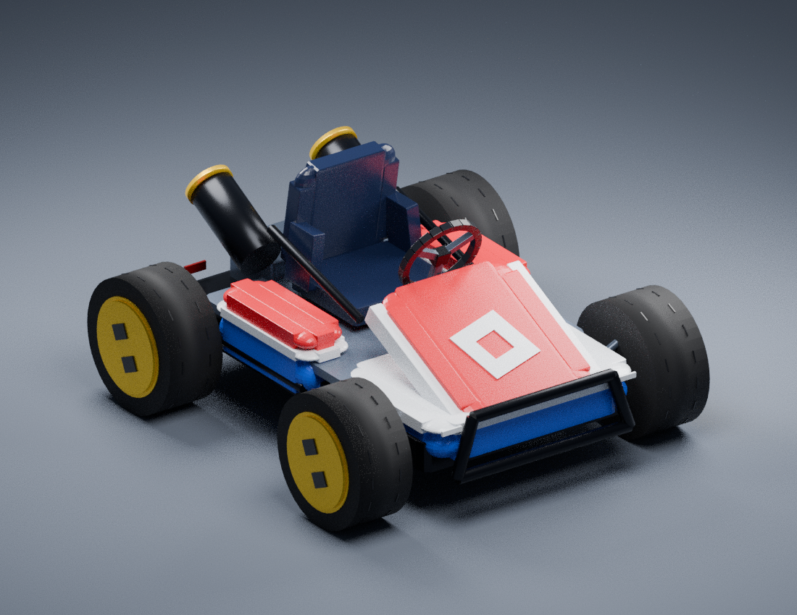

# Fun Run racing kart

An upgrade of the existing kart system: compact red nose with rounded edges and a flush white tilted-square emblem, white trim, blue lower body, yellow disc rims, dark blue bucket seat, black tubular bumper/frame, compact exposed engine and twin black/yellow exhausts. The existing seat, controls, R15 grips, four wheel assemblies, multiplayer authority and boost system are retained. Six upper-body paint colors remain available. No uploaded assets or external textures are required.



This preview is rendered from the actual Luau builder's exported Parts, with Blender studio lighting and softened rendering edges. It is a geometry preview, not evidence of Roblox physics, avatar fit, or exact Studio shading.

## Try the included place

1. Open **dist/KartDemo.rbxlx** in Roblox Studio using **File → Open from File**. This is a separate flat test place; it does not modify your terrain/game.
2. In Avatar Settings, select **R15**. Press **Play**, walk to the kart, and press **E**.
3. Drive with **WASD / arrows**, hold **Space + a turn** to drift, release Space for a charged boost, and hold **Shift** for a rechargeable turbo. **E or F** exits. Space is reserved for drifting while driving, so use the exit key rather than jump.
4. Gamepad: left stick steers/throttles, R2 accelerates, L2 brakes/reverses, A drifts, X boosts, B exits. Touch buttons are supplied too; verify their layout on your target devices.

The kart is generated when the server starts. The avatar spawn is near it. No internet/security settings need to be enabled.

## Upgrade the kart you already installed

1. Download and extract the latest **dist/KartRelease.zip**. Stop Play mode in Studio and save your place.
2. Insert **dist/KartPackage.rbxmx** into Workspace, then select the newly imported **KartPackage** folder.
3. Open **View → Command Bar**, paste all of **tools/Upgrade.command.luau**, and press Enter. Use **Upgrade**, not the first-install script.
4. The command backs up the installed scripts to **ServerStorage/KartBackups/BeforeUpgrade_…**, replaces only the three kart modules and two kart scripts, and keeps **KartSpawns**, custom modules, spawn position, paint palette and customized first-release tuning. Unchanged old settings receive the new smoother defaults. The imported package disappears after a successful upgrade.
5. Press Play. Existing spawn markers generate the updated kart. Run the Studio checks below before saving the updated game.

Customized suspension/grip settings override the new defaults; compare KartConfig if you previously tuned them. Source modifications to KartBuilder/KartDynamics/KartServer/KartController are retained in the backup, but are not automatically merged into the updated implementation. No track geometry is changed.

To roll back in Edit mode, replace the installed KartSystem with the backed-up KartSystem in ReplicatedStorage, KartServer in ServerScriptService, and KartController in StarterPlayer/StarterPlayerScripts. Keep your existing KartSpawns.

## Install into your existing game

Back up your place first. The installer rejects an existing KartSystem/KartServer/KartController instead of replacing your work.

1. Stop Play mode. In Explorer, right-click Workspace and choose **Insert from File**, then select **dist/KartPackage.rbxmx**. Some Studio versions expose this through the Model tab's **Advanced → Insert from File**. This is a script package, not a mesh; do not use the 3D importer.
2. Select the imported **KartPackage** folder. Open **View → Command Bar** and paste/run the contents of **tools/Install.command.luau**. The scripts are disabled inside the imported folder until installation places and enables them in their proper services.
3. Add a Folder named **KartSpawns** to Workspace. Inside it, place anchored Parts at the desired chassis spawn positions, about **4 studs above the ground**, oriented so their **front (-Z)** points down the track. The server hides these markers and disables their collisions. Use one marker per kart; optional string attribute **ColorName** accepts `Red`, `Blue`, `Green`, `Yellow`, `Purple`, or `Black`.
4. With no markers, one red kart spawns at `KartConfig.SpawnCFrame`, initially `(0, 5, 0)`. Change that setting for your map rather than assuming the terrain is at Y=0.
5. Select R15 in Avatar Settings and press Play. Save the place after successful tests. The terrain files in this repository are left unchanged.

Alternatively use **Rojo** with `default.project.json`, or create the five script instances manually from `src/` using the same names/services. Do not install twice. Rojo is optional and is not bundled.

```text
ReplicatedStorage/KartSystem
  KartConfig       ModuleScript: tuning and palette
  KartDynamics     ModuleScript: tested speed/braking/tier calculations
  KartBuilder      ModuleScript: complete geometry and constraint assembly
  Remotes/Input    RemoteEvent: created at server startup
ServerScriptService/KartServer
StarterPlayer/StarterPlayerScripts/KartController
Workspace/RacingKarts/RacingKart  (generated at runtime)
```

## Implementation and tuning

- **Stability:** spring forces run in PreSimulation at four contact points. Springs use a lower 2 Hz frequency, near-critical heave damping and bounded loads. Angular point velocity is deliberately excluded from corner damping: applying four strong point dampers to a narrow, low-inertia chassis creates excessive roll feedback. A separate inertia-scaled pitch/roll damper handles rotation. Suspension and stability torque do not teleport or anchor a driven kart.
- **Force separation:** one COM-applied VectorForce handles forward/lateral traction; one bounded yaw torque handles steering. This replaces the old axle-sideways-velocity target that also generated a competing yaw moment. Physical chassis/curb shells remain; visual tires stay massless and non-colliding. Driver body parts are temporarily massless and have NoCollisionConstraints against the kart hull, keeping animated limbs from changing assembly inertia or colliding with the vehicle. Original Massless values are restored on exit.
- **Drifting:** frame-rate-independent steering/throttle filters; drift blend eases grip and the outward side-slip target in and out. The rear-slide effect follows steering, with bounded lateral acceleration and yaw. Grip remains positive throughout and no sideways velocity is assigned. Charge thresholds, mini-turbo release and cooldown protections are preserved. Tune SteerResponse, DriftEnterResponse/DriftExitResponse, DriftSlipAngle, Grip and DriftGrip in KartConfig.
- **Suspension/wheels:** four raycast contacts independently position the wheels. Server contact distances and steering targets replicate at 20 Hz; **every client** renders smooth wheel travel, signed spin from each contact's actual local velocity, and steering-wheel rotation at its render rate. Server code no longer also writes visual wheel poses. Observers use the same replicated targets, without relying on driver-only animations. R15 IK targets follow the locally animated wheel, with server-created grip controls. Standard seated legs and server-replicated torso lean are retained. R6 drives without hand IK; nonstandard R15 proportions may need grip adjustment.
- **Camera:** independent horizontal, vertical and heading filters; horizontal lag compensation, limited drift-direction following, obstacle raycasts, gradual FOV and **no procedural shake**, including turbo. Suspension pitch/roll do not directly rotate the camera. Camera settings restore on exit.
- **Boosts/effects:** continuous grounded drift earns blue/orange/purple tiers after 0.65 / 1.5 / 2.7 seconds; release while grounded redeems the charge. No airborne or stationary charge, no additive speed stacking, finite durations and six-second turbo cooldown. Bounded tire smoke/sparks, subtle acceleration exhaust, turbo flames, brake lamps and high-speed screen lines remain. Futuristic neon tire rings and the oversized spoiler were replaced to match the new reference.
- **Multiplayer/lifecycle:** server-owned physics; occupant-validated, finite-checked, clamped/rate-limited inputs; 0.5-second input timeout. No client-supplied physics velocities or boost strength. Empty karts settle and park, entering unanchors them, and falling near the destroy plane returns them to the marker. Camera/input/grips/driver mass flags restore on exit/death. Server ownership still has network latency; no prediction is implemented.
- **Cost:** 295 connected Parts per kart in the geometry check, four ground raycasts per simulation update, 20 Hz effect/target replication. Visual wheel work runs per render on observers. Profile your intended kart count on mobile. Model streaming is atomic. No separate replacement vehicle system is installed.

## Validation status

Executed in the cloud: all Luau files compile using official Luau **0.726**; **94 dynamics assertions pass** at 30/60/120 Hz. They cover existing speed/braking/boost protections plus interpolation independence, gradual drift entry/exit, slip direction, yaw limits and simplified heave/pitch/roll settling. The actual KartBuilder executes in a geometry-only mock: all **295 parts** have positive sizes, finite transforms, a connected weld/motor graph, massless visuals and non-colliding animated tires. Both Studio XML artifacts parse, with all five embedded sources matching the originals. Enum references and literal Instance class names were checked against Roblox's public API dump.

The numerical suspension tests use a simplified small-angle model, not the Roblox solver; the builder mock validates geometry construction, not Roblox engine behavior. The new code addresses identifiable feedback and presentation problems; **zero rumble in Studio is not yet verified**.

**Roblox Studio is unavailable in this environment.** The generated place has not been opened or run here. Studio physics, import compatibility, avatar grip alignment, visual fidelity, device input and multiplayer behavior remain unverified. The engine-independent tests do not certify those behaviors. Use the following checks before including this in a live game.

## Studio acceptance checklist

Run `tests/StudioSmoke.command.luau` in the **server Command Bar during Play** to inspect the actual generated assembly. While seated, run `tests/StudioMeasurements.command.luau` and drive straight on a flat baseplate for 10 seconds to record RMS/peak vertical and roll/pitch velocity. Compare before/after on the same place, speed, avatar and frame rate; collisions, ramps and entering/exiting invalidate a flat-road comparison. These measurements have not been run here. Then perform these behavioral checks; watch Output for errors throughout.

| Check | Expected result |
| --- | --- |
| E enter; E/F exit; enter again; reset character | One driver, normal seated pose, camera/input restored on exit, empty kart parks |
| W, release, S; hold S after stopping | Accelerates smoothly, coasts, brakes, then reverses; no unbounded speed |
| Flat road; enter and exit drift repeatedly | No sustained chassis oscillation, smooth grip changes, no heading snaps or camera rumble |
| A/D at low and high speeds | Correct turning direction, front wheels steer, rear wheels remain aligned; wheel spin matches forward/reverse |
| R15 driver and observer | Hands stay near wheel grips through both turns; wheel centers smoothly; no detached avatar |
| Hold W + turn + Space for each threshold | Blue → orange → purple sparks; smoke only during drift; release earns a temporary boost |
| Tap/release Space, drift in air, stop turn, spam Shift | No free charge, no airborne charge, finite boost, six-second turbo recharge |
| Boost then release acceleration; brake | Flames/FOV/lines activate and clear; speed returns to normal; brake lamps respond |
| Add a 10–20° ramp, small bumps, a wall and a ledge | Individual suspension movement, uphill/downhill drive, collisions, no sustained rollover/jitter; verify your actual candy terrain too |
| Studio Test → Server & Clients, two clients, two markers | Both karts independent; second player cannot steal an occupied kart; observer sees wheels, grips, sparks |
| Simulated latency, minimize window, disconnect driver | Safe input timeout, no stuck accelerator, no stale IK; assess server-owned input latency |
| Gamepad and phone emulator | Steering/throttle, drift/boost/exit work; HUD/buttons do not obstruct necessary UI |

If contact is unstable, first ensure spawn markers are above collidable ground and no other script moves the kart or assigns it client ownership. Then adjust SpringFrequency / SpringDamping in small increments. Tune MaxSpeed, Grip and MaxSteer on your actual track. Do not use cloud tests as a substitute for the Studio acceptance checks.

## Rebuild artifacts and rerun cloud checks

From `kart/`:

```sh
python3 tools/package.py
python3 tools/check_geometry.py --luau /path/to/luau --output /tmp/kart-geometry.json
python3 tools/test.py --luau /path/to/luau --compiler /path/to/luau-compile
```

Optional geometry preview: run Blender in background with `--python tools/render_preview.py -- /tmp/kart-geometry.json dist/KartPreview.png`, then regenerate the package. Blender is required only for this optional render.

Python uses only the standard library. The test runner requires the official Luau CLI and compiler; Roblox Studio supplies the actual runtime instead. Regenerate `dist/` whenever source scripts change. `dist/source-hashes.json` records the packaged source hashes. No environment secrets or onboarding configuration changes are needed for the kart itself.
