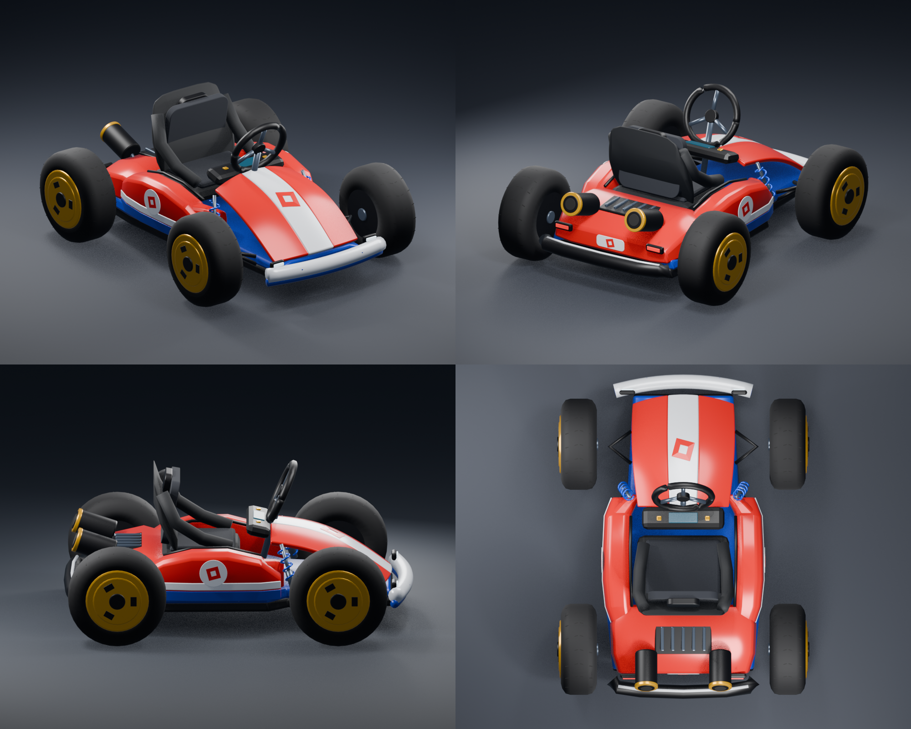

# Compact Blender kart and six-racer corner HUD

This release remodels the existing drivable kart and completely replaces the old instrument cluster. The current boost remains the benchmark: fresh installs charge for **0.50 seconds** and fire on **Shift release**, with the same 1.5-second duration, power and six-second cooldown. Upgrades preserve existing boost settings, including an explicitly configured 0.9-second charge.

The actual export contains **123 separate meshes and 31,282 triangles** (largest object: 906 triangles). The Blender model has sculpted red sidewalls, a curved nose, blue/white lower trim, a tapered lower shell, compact rear housing and bumper, twin exhausts, a bucket seat, yellow rims and separate animated wheel/steering meshes. Wheel centers move inward from ±2.68 to ±2.20 canonical studs; tire radius changes from 1.05 to 0.96 and width from 0.91 to 0.76. The existing 0.84 assembly scale stays the same. The avatar is never scaled.

**The actual Blender meshes require one FBX import through your Studio account.** The package also includes a redesigned native-Part fallback, so driving and the new HUD work before that import. The renders above show the Blender meshes. No mesh asset IDs are fabricated or silently borrowed from another account.

## Install or upgrade

1. Download and extract **dist/KartRelease.zip**. Stop Play and save your place.
2. Insert **dist/KartPackage.rbxmx** into Workspace with **Insert from File**. Select the new **KartPackage** folder.
3. Paste all of **tools/Upgrade.command.luau** into Studio’s Edit **Command Bar** and press Enter. Install.command.luau is identical and also supports first installations.
4. Import **dist/KartRemodel.fbx** with Studio’s **3D Importer**, retaining all objects and their names, including KartOrigin, KartForward and KartUp. Upload under the experience owner/group with permission to use the meshes.
5. Select the whole imported Model and run **tools/ImportBlender.command.luau** in the Edit Command Bar. Press Play.

The mesh helper uses three alignment markers to correct FBX units, orientation and placement. It attaches body meshes to the chassis, wheel meshes to each existing tire carrier, and steering meshes to the steering hub. It preserves the seat, motors, hand targets, suspension forces and collision hull. It does not convert the kart into a static model. Detailed import options, pivots and rollback: **[BLENDER_IMPORT.md](BLENDER_IMPORT.md)**.

The installer verifies backups in **ServerStorage/KartBackups** before replacing the ten named modules and two driving scripts. It retains **Workspace/KartSpawns**, **Workspace/KartRace**, unrelated custom modules and an imported **KartMeshTemplate**. Compatible custom driving/camera settings and paint/spawn settings carry over. Geometry uses the new coordinated track, wheelbase, radius and suspension defaults. All existing turbo charge, activation, duration, power, cooldown and eligible-speed tuning carries over. Modified source is backed up rather than automatically merged.

The mesh helper backs up the original import and previous mesh template before installation. If a template is absent or malformed, the native kart remains visible and drivable. During Play, inspect the kart’s **VisualSource** attribute: **Blender** confirms the imported template was applied; **Native** means the fallback is in use.

## Model and driving

- **Actual Blender deliverables:** KartRemodel.blend, KartRemodel.fbx, KartRemodel.manifest.json and the reproducible tools/build_kart_blender.py. Separate named groups cover body, nose, side pods, rear housing/bumper, seat, steering wheel, four wheels, exhausts and chassis. Material-role suffixes map to Roblox materials; primary paint follows each kart’s palette.
- **Native fallback:** 372 connected Parts with enclosed curved bodywork and narrower wheels. The invisible original collision hull retains its dimensions and inertia baseline. The rendered body uses a tapered shell; visual parts remain massless and non-colliding.
- **Wheel motion:** every observer uses actual signed wheel-point velocity and the configured tire radius. Forward/reverse spin, suspension interpolation and front steering remain independent of physics forces. Analytic smoothing gives the same wheel rotation at 30/60/120 FPS; parked tires ignore tiny replication noise. Steering meshes and R15 hand targets follow the existing steering motor.
- **Driving:** the existing server-owned raycast springs, center-of-mass traction, angular damping, input validation and boost calculations remain. No extra physical wheel constraints compete with suspension. The narrower contact positions and smaller radius agree with the new model.
- **Camera:** filtered planar/vertical follow, restrained drift following, lower rear view, obstacle raycast, smooth speed/boost FOV and no procedural shake. Recovery teleports reset the camera filter. CameraDistance, CameraHeight, CameraLookAhead and CameraFocusHeight are configurable.
- **Seat lock:** entry still works. A living assigned driver cannot voluntarily exit. Death/reset, character replacement, disconnect and kart destruction restore settings and clean up IK/input/camera. Standard R15 and larger avatar fit still need Studio checks.

The mesh and native remodels preserve the existing boost calculations; wheel motion and camera changes are presentation only. The different wheel placement can affect vehicle contact behavior, so driving feel still requires Studio validation.

## New HUD

The old speedometer, MPH dial, horizontal turbo bar and instrument panels are removed. The replacement uses the supplied racing screenshot’s layout:

- **Top left:** compact angled dark coin and lap panels with gold coin/checkered flag icons.
- **Top right:** at most six real racers, each with place, actual Roblox headshot, trophy and career wins. First place has gold accents; the local row has a gold outline. Rows move smoothly as standings change.
- **Bottom left:** large orange/gold placement numeral with layered outline/shadow and metallic ordinal suffix.
- **Bottom right:** a fixed map of the configured course path, a checkered start/finish marker and live server-position markers. The local racer is gold.

No controls, speed units, manual-turbo buttons or exit buttons appear in this HUD. Touch driving/drift controls remain separate. On mobile, placement and minimap move above those controls. GUI objects, rows, markers and thumbnails are reused; course geometry rebuilds only for a completed path revision. Respawn/cleanup does not create duplicate HUDs. Missing or unavailable values show **—**; empty slots do not invent participants.

The preview uses the actual native GUI hierarchy with explicitly labeled sample racers. Headshots are pending in this offline preview; the game requests real headshots by UserId. It is not a Studio screenshot.

## Course, standings and real data

Set the published experience’s **maximum players to six** in Roblox settings. The server also admits at most six racers to a round; extra drivers cannot take a race slot. Slots survive a driver’s reset; unfinished disconnects free a slot, and finished places remain reserved until round reset.

Create **Workspace/KartRace**:

- **Checkpoints:** anchored non-colliding Parts with contiguous integer Order attributes 1 through N, or numeric names 1 through N. At least two gates are required. Gate 1 is start/finish.
- **Path:** ordered anchored Parts following the actual centerline around the closed circuit. Start near gate 1, follow the gates in race order, and include enough nodes to describe bends. Order uses the same attribute/numeric-name rule. If omitted, the checkpoint polyline is used as an explicitly coarse course map.
- **Coins:** optional Parts with positive integer Value attributes (default 1). Pickup checks use actual server position/swept travel, once per player per round. Markers remain visible; this package does not add collectible artwork or saved coin currency.
- Optional KartRace **TotalLaps** attribute; otherwise RaceTotalLaps defaults to 3.

Managed racers must cross gate 1 to start, then visit every gate in order. Standings compare completed laps, last validated checkpoint, and projection along the legal path leg toward the next gate. A nearby later section cannot skip checkpoints. Off-track projection is bounded by RaceTrackWidth; ties are stable. Finishing order uses swept crossing times rather than kart iteration order. An unconfigured or incompatible course produces unknown placement and no decorative minimap.

KartRace publishes **ReplicatedStorage/KartSystem/RaceState** with versioned Path nodes and six Racer records. The HUD consumes these server snapshots; clients cannot submit place, lap, coin, win or boost values.

### Existing race systems

RaceStatNames binds real player attributes/leaderstats: Lap/CurrentLap, TotalLaps/MaxLaps, Coins, and Wins/Trophies. External values are never overwritten. To use external race progress for standings, configure **RaceProgressBinding** and publish server-owned values:

| Field | Default attribute/leaderstat names | Meaning |
| --- | --- | --- |
| Checkpoint | RaceCheckpoint, Checkpoint | Last passed gate, 1 through N |
| CompletedLaps | RaceCompletedLaps, CompletedLaps | Fully completed laps, starting at 0 |
| Progress | RaceSegmentProgress, SegmentProgress | Fraction 0–1 along the current validated checkpoint leg |
| Finished | RaceFinished | Boolean completion flag |
| FinishOrder | RaceFinishOrder | Unique final place, 1–6; publish before Finished |

A bound external Lap opts into external race ownership. Supply the complete checkpoint/completed-lap/segment schema for accurate standings. When an admitted racer has an external Lap but incomplete progress bindings, placement is unavailable for the match instead of ranking incompatible races. Real lap/coin/win values and map positions remain available. This ambiguity blocks automatic finishes/wins for the round; repair the bindings and call ResetRace to start a coherent round. Reset the external system’s progress before starting another round; stale finished snapshots cannot award another win.

### Career wins

Existing Wins/Trophies bindings take precedence and remain owned by your game’s persistence system. Without such a binding, **KartCareerWins** loads and saves real career wins using DataStoreService and the configured CareerWinsDataStore name. Only a validated round winner receives an award. UpdateAsync merges idempotent session award sequences, retries failures and flushes pending writes on removal/shutdown. Failed or incomplete loads remain unknown, never placeholder zero.

Publish the experience to test storage. Studio storage tests need **Enable Studio Access to API Services**; use a separate test experience or CareerWinsDataStore name for test data. Storage availability and shutdown deadlines can prevent a write from being confirmed; failed pending awards are reported in Output. CareerWinsEnabled=false disables the built-in store and leaves external bindings available.

Reset a managed round from a **server** script/Command Bar:

~~~lua
game.ServerScriptService.KartServer.ResetRace:Fire()
~~~

Reset clears route progress and per-round coin availability, retaining session coins and career wins. The included **KartDemo.rbxlx** has six paint-colored kart spawns, four gates, actual route waypoints/road and coin markers. It is a functional test course, not the castle environment pictured in the reference.

## Checks and remaining Studio validation

The automated workflow compiles every Luau file, runs actual modules with offline service doubles, checks geometry, and embeds all twelve source scripts consistently in both Studio XML artifacts. It checks:

- Boost charging/release, early release, invalid conditions, cooldown and repeated input at 30/60/120 Hz.
- Seat-lock ownership, cancellation and exact character-setting restoration.
- Native/model wheel dimensions, narrower track and correct pivots/scaling. The real FBX re-import checks 40 wheel-component envelopes over 140 steering/suspension poses against 82,527 body surface samples; the native fallback checks 200 poses.
- Mesh import normalization, all four wheel carriers, steering welds, invalid-template fallback and material/paint/brake roles.
- HUD real/unknown values, six-place rows, real-user thumbnail caching, mobile clearance, course versioning and delayed replication recovery.
- Ordered/swept race progress, six-racer admission/position changes, finished-slot accounting, off-track/teleport cases, external bindings and stale round results.
- Career storage load failures, concurrent/idempotent writes, retries and shutdown behavior.
- Installer backups, custom tuning/template preservation, partial repairs and rejected input.

**Roblox Studio is unavailable in this environment.** Actual FBX upload/import, rendered Roblox materials, R15 reach, collision response, live driving, six-client multiplayer, mobile rendering, real DataStore access and Studio Output acceptance remain to be checked. Offline tests and Blender renders do not establish those results.

In Studio, test normal/reverse driving and stationary/airborne wheel animation, full steering/suspension clearance, comfortable R15 seating/hand grips, the rear camera, death/reset cleanup, all six positions/overtakes and finishes, real coins/laps/wins, minimap markers on your actual course, and mobile layouts. Compare turbo acceleration/duration against your existing installation. Run **tests/StudioSmoke.command.luau** in the server Command Bar during Play for assembly checks; it does not replace a driving/multiplayer playtest.

## Rebuild

From kart/ with Python and official Luau installed:

~~~sh
python3 tools/test.py --luau /path/to/luau --compiler /path/to/luau-compile
~~~

This compiles scripts, runs meaningful offline checks and regenerates both Studio XML files, source hashes and the release ZIP. Regenerate dist after source edits.

Rebuild the actual Blender assets with installed Blender:

~~~sh
blender --background --python tools/build_kart_blender.py
blender --background --python tools/check_blender_mesh.py -- dist/KartRemodel.fbx
~~~

Blender renders and FBX round-trip validation are separate from Studio engine tests. Optional HUD preview (Pillow):

~~~sh
python3 tools/check_hud.py --luau /path/to/luau --export-graph /tmp/kart-hud-graph.json
python3 tools/render_hud_preview.py /tmp/kart-hud-graph.json dist/KartHUDPreview.png
~~~
